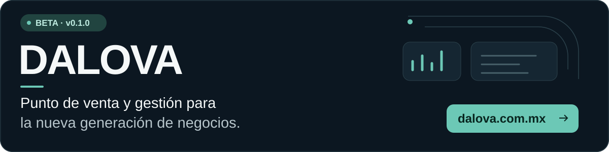
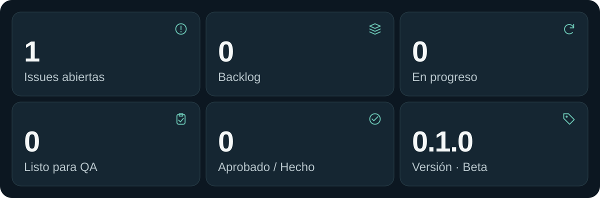

<a href="https://dalova.com.mx">
<picture>
  <source media="(max-width: 640px)" srcset="https://raw.githubusercontent.com/DALOVA-MX/.github/main/profile/assets/hero-mobile.svg?v=542bda178008f1b9ae77">
  
</picture>
</a>

### Estado de DALOVA

<picture>
  <source media="(max-width: 640px)" srcset="https://raw.githubusercontent.com/DALOVA-MX/.github/main/profile/assets/status-mobile.svg?v=542bda178008f1b9ae77">
  
</picture>

### Una plataforma para operar tu negocio.

<picture>
  <source media="(max-width: 640px)" srcset="https://raw.githubusercontent.com/DALOVA-MX/.github/main/profile/assets/product-mobile.svg?v=542bda178008f1b9ae77">
  
</picture>

TypeScript · React · Fastify · PostgreSQL · Tauri · Next.js

Estadísticas agregadas automáticamente. El código y la operación interna permanecen privados. 
Última actualización: 9 nov 2026 · 06:19 UTC 
<a href="https://dalova.com.mx">dalova.com.mx</a>

